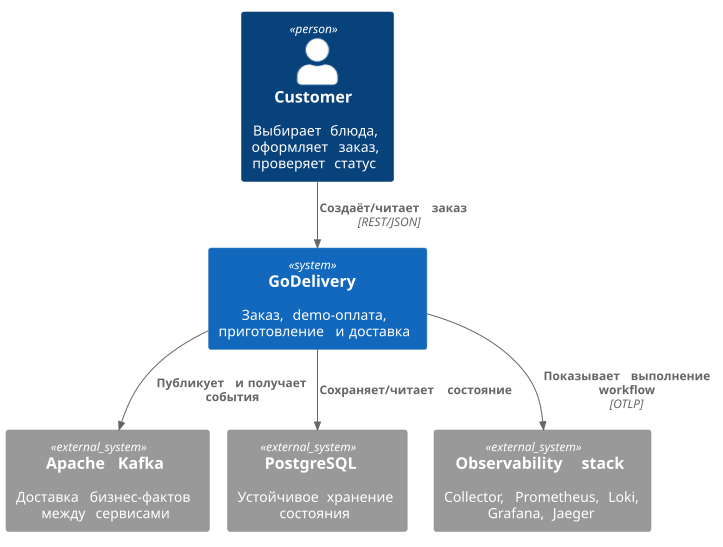

# C4 Context



Customer хочет завершённую доставку. Kafka и PostgreSQL — инфраструктурные зависимости окружения, не новые business services. Observability наблюдает поведение, не принимает бизнес-решения.

```plantuml
@startuml
!includeurl https://raw.githubusercontent.com/plantuml-stdlib/C4-PlantUML/v2.12.0/C4_Context.puml
LAYOUT_TOP_DOWN()
Person(customer, "Customer", "Выбирает блюда, оформляет заказ, проверяет статус")
System(godelivery, "GoDelivery", "Заказ, demo-оплата, приготовление и доставка")
System_Ext(kafka, "Apache Kafka", "Доставка бизнес-фактов между сервисами")
System_Ext(db, "PostgreSQL", "Устойчивое хранение состояния")
System_Ext(telemetry, "Observability stack", "Collector, Prometheus, Loki, Grafana, Jaeger")
Rel(customer, godelivery, "Создаёт/читает заказ", "REST/JSON")
Rel(godelivery, kafka, "Публикует и получает события")
Rel(godelivery, db, "Сохраняет/читает состояние")
Rel(godelivery, telemetry, "Показывает выполнение workflow", "OTLP")
@enduml
```
