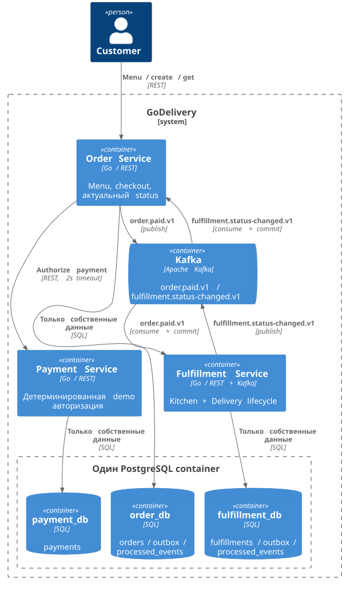

# C4 Container



Один PostgreSQL container не означает общую бизнесовую БД. Каждая база имеет владельца и собственные migrations. Kitchen и Delivery объединены в Fulfillment только для обучения.

```plantuml
@startuml
!includeurl https://raw.githubusercontent.com/plantuml-stdlib/C4-PlantUML/v2.12.0/C4_Container.puml
LAYOUT_TOP_DOWN()
Person(customer, "Customer")
System_Boundary(system, "GoDelivery") {
 Container(order, "Order Service", "Go / REST", "Menu, checkout, актуальный status")
 Container(payment, "Payment Service", "Go / REST", "Детерминированная demo авторизация")
 Container(fulfillment, "Fulfillment Service", "Go / REST + Kafka", "Kitchen + Delivery lifecycle")
 ContainerQueue(kafka, "Kafka", "Apache Kafka", "order.paid.v1 / fulfillment.status-changed.v1")
 Boundary(postgres, "Один PostgreSQL container") {
  ContainerDb(orderdb, "order_db", "SQL", "orders / outbox / processed_events")
  ContainerDb(paymentdb, "payment_db", "SQL", "payments")
  ContainerDb(fulfillmentdb, "fulfillment_db", "SQL", "fulfillments / outbox / processed_events")
 }
}
Rel(customer, order, "Menu / create / get", "REST")
Rel(order, payment, "Authorize payment", "REST, 2s timeout")
Rel(order, orderdb, "Только собственные данные", "SQL")
Rel(payment, paymentdb, "Только собственные данные", "SQL")
Rel(fulfillment, fulfillmentdb, "Только собственные данные", "SQL")
Rel(order, kafka, "order.paid.v1", "publish")
Rel(kafka, fulfillment, "order.paid.v1", "consume + commit")
Rel(fulfillment, kafka, "fulfillment.status-changed.v1", "publish")
Rel(kafka, order, "fulfillment.status-changed.v1", "consume + commit")
@enduml
```
