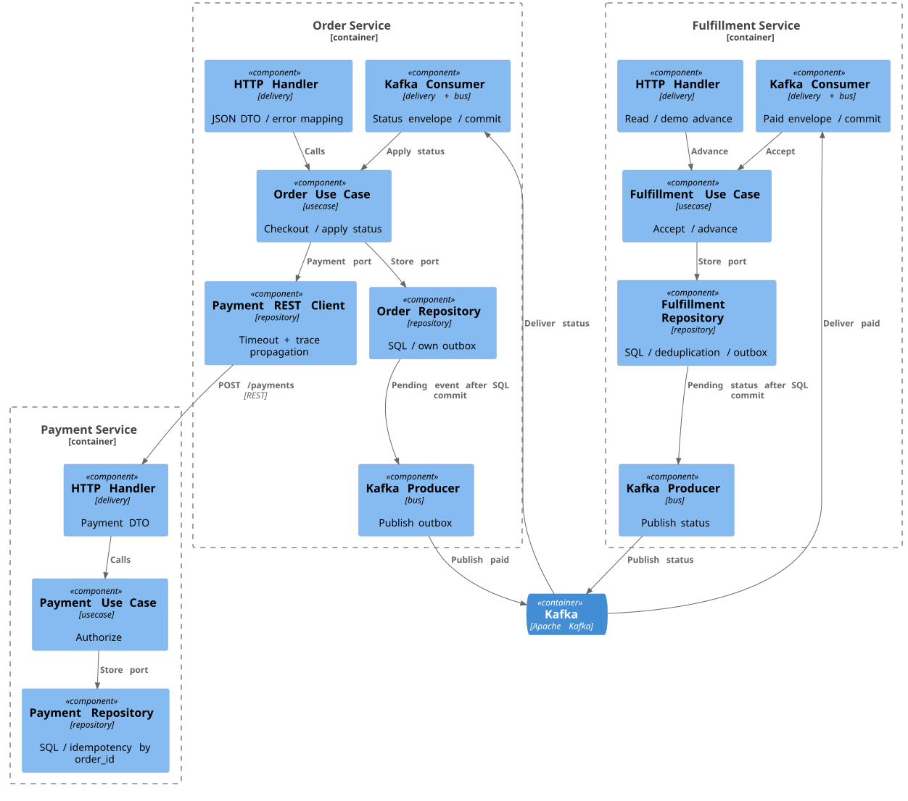

# C4 Component: порты и адаптеры



Зависимости собираются конструкторами в main.go. Use case определяет нужные порты; adapters реализуют их. Domain остаётся чистым. Стрелки показывают runtime workflow; compile-time Dependency Inversion описана рядом с кодом интерфейсов.

```plantuml
@startuml
!includeurl https://raw.githubusercontent.com/plantuml-stdlib/C4-PlantUML/v2.12.0/C4_Component.puml
LAYOUT_TOP_DOWN()
Container_Boundary(order, "Order Service") {
 Component(oh, "HTTP Handler", "delivery", "JSON DTO / error mapping")
 Component(ou, "Order Use Case", "usecase", "Checkout / apply status")
 Component(or, "Order Repository", "repository", "SQL / own outbox")
 Component(oc, "Payment REST Client", "repository", "Timeout + trace propagation")
 Component(op, "Kafka Producer", "bus", "Publish outbox")
 Component(ok, "Kafka Consumer", "delivery + bus", "Status envelope / commit")
}
Container_Boundary(payment, "Payment Service") {
 Component(ph, "HTTP Handler", "delivery", "Payment DTO")
 Component(pu, "Payment Use Case", "usecase", "Authorize")
 Component(pr, "Payment Repository", "repository", "SQL / idempotency by order_id")
}
Container_Boundary(fulfillment, "Fulfillment Service") {
 Component(fh, "HTTP Handler", "delivery", "Read / demo advance")
 Component(fu, "Fulfillment Use Case", "usecase", "Accept / advance")
 Component(fr, "Fulfillment Repository", "repository", "SQL / deduplication / outbox")
 Component(fp, "Kafka Producer", "bus", "Publish status")
 Component(fk, "Kafka Consumer", "delivery + bus", "Paid envelope / commit")
}
ContainerQueue(kafka, "Kafka", "Apache Kafka")
Rel(oh, ou, "Calls")
Rel(ou, or, "Store port")
Rel(ou, oc, "Payment port")
Rel(oc, ph, "POST /payments", "REST")
Rel(ph, pu, "Calls")
Rel(pu, pr, "Store port")
Rel(or, op, "Pending event after SQL commit")
Rel(op, kafka, "Publish paid")
Rel(kafka, fk, "Deliver paid")
Rel(fk, fu, "Accept")
Rel(fh, fu, "Advance")
Rel(fu, fr, "Store port")
Rel(fr, fp, "Pending status after SQL commit")
Rel(fp, kafka, "Publish status")
Rel(kafka, ok, "Deliver status")
Rel(ok, ou, "Apply status")
@enduml
```
