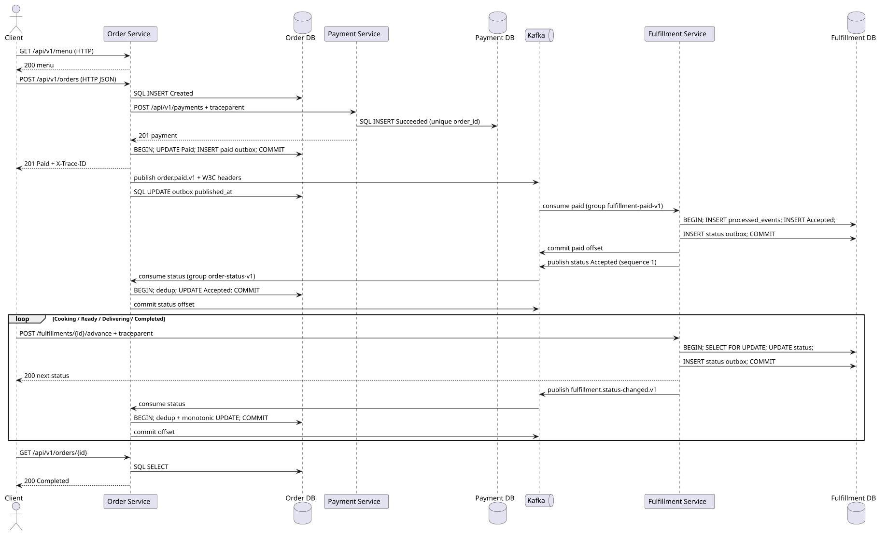
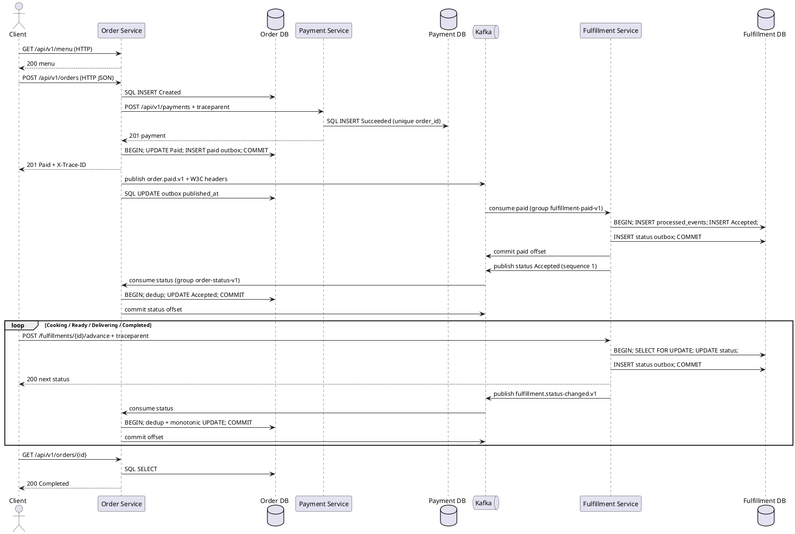

# Sequence: happy path и commit boundary

HTTP 201 закрывает checkout, но не доставку. Статус приходит обратно асинхронно. В каждом consumer commit offset следует за SQL commit. Header traceparent идёт через HTTP, outbox metadata и Kafka headers.

